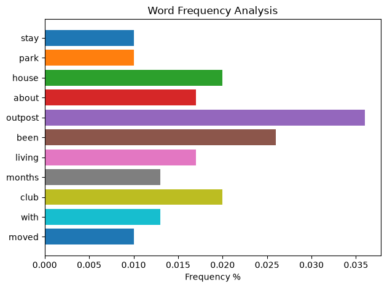

## **Project Summary**
This project analyses user reviews of Outpost (a property listing site), the reviews are scraped from [ProductHunt](https://www.producthunt.com/products/outpost-club/reviews?feed=single&filter=all) using the python BeautifulSoup package and dumped into an Excel file output for cleaning. Afterwards, `Sentiment` and `Word Frequency` Analysis were performed.

## **Objectives**
- User review sentiment and satisfaction analysis (`positive`, `neutral` and `negative`) to understand overall perception of customer toward the services being provided
- Identifying user needs & pain points through Word Frequency analysis to uncover areas for improvement of services
- Generate actionable insights from users feedback to inform product positioning & messaging

## **Key Steps**
### 1. Data Preparation
- scraped data using `BeautifulSoup`
- dumped output into an Excel workbook file for quick and proper data cleaning

### 2. Prescriptive Analysis
- performed `Sentiment` and `Word Frequency` on the reviews set
- analysis insights to aid product positioning & messaging

## **Skills Demonstration**
- **Python:** Data scraping, Data formating, Data loading, application of Natural Language Processing Toolkit, Data visualization

- **Excel:** Data cleaning, Usage of advanced nested formulas

## **Next Steps**
- Due to how small the scraped reviews dataset are (`< 30 rows`), I will in the future rewrite the code to scrape businesses with larger datasets (`> 2000 rows`)



## **Project Artifacts**
```customer_insights/
│
├── main.ipynb/                 # Python notebook containing analysis code
├── reviews.xlsx/               # Excel file generated by panda from the scraped data
├── word_frequency.png/         # Most appeared words from user reviews
├── README.md/                  # Project documentation 
```